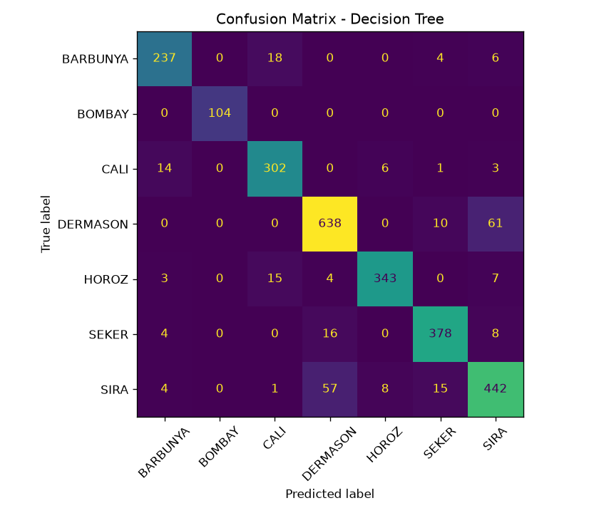
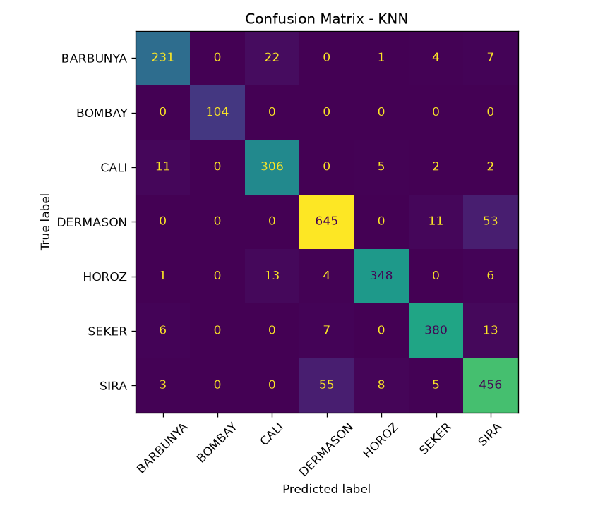
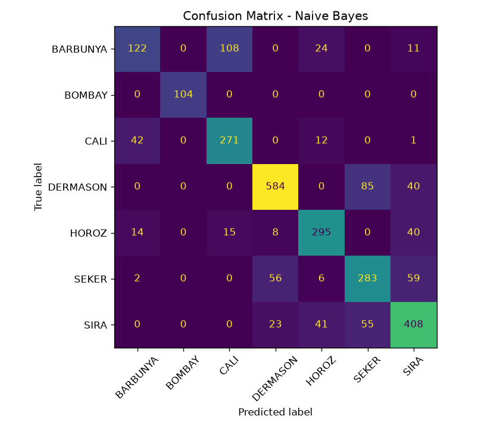

# ML Assignment 2: Dry Bean Classification

**Course:** Machine Learning, M.Tech (AIML), BITS Pilani WILP  
**Name:** Kshitiz Sahai  
**BITS ID:** 2026AJ05035  
**Date:** 08-11-2026  

---

# Dry Bean Classification

### a. Problem Statement

<Rewrite in your own words.> The goal is to classify dry bean grains into one of
seven varieties (BARBUNYA, BOMBAY, CALI, DERMASON, HOROZ, SEKER, SIRA) using 16
shape and size measurements extracted from images of individual grains. Five
classification models (Logistic Regression, Decision Tree, K-Nearest Neighbors,
Gaussian Naive Bayes and Support Vector Machine) are trained on the same
dataset, compared using six evaluation metrics, and deployed as an interactive
Streamlit web application.

### b. Dataset Description

| Item | Details |
|---|---|
| Source | UCI Machine Learning Repository, Dry Bean Dataset (https://archive.ics.uci.edu/dataset/602/dry+bean+dataset) |
| Citation | Dry Bean [Dataset]. (2020). UCI Machine Learning Repository. https://doi.org/10.24432/C50S4B |
| License | CC BY 4.0 |
| Task | Multi-class classification (7 classes) |
| Instances | 13,611 originally; 13,543 after removing 68 duplicate rows |
| Features | 16, all numeric (2 integer, 14 continuous) |
| Target | `Class` (BARBUNYA, BOMBAY, CALI, DERMASON, HOROZ, SEKER, SIRA) |
| Missing values | None |
| Duplicates | 68 exact duplicate rows (all in HOROZ), removed before splitting |
| Train/test split | 80/20, stratified, random_state=42 (10,834 train / 2,709 test rows) |
| Preprocessing | Duplicates removed; StandardScaler applied inside the pipeline for Logistic Regression, KNN and SVM; Decision Tree and Naive Bayes use raw features |

**Features:** Area, Perimeter, MajorAxisLength, MinorAxisLength, AspectRation,
Eccentricity, ConvexArea, EquivDiameter, Extent, Solidity, roundness,
Compactness, ShapeFactor1, ShapeFactor2, ShapeFactor3, ShapeFactor4.

The features are shape and size measurements taken from images of individual
bean grains. Their scales differ greatly (Area ranges from about 20,420 to
254,616, while Solidity stays between about 0.92 and 0.995), so scaling is
needed for distance-based and margin-based models.

**Class distribution (after removing duplicates):**

| Class | Original count | Count used | Share |
|---|---|---|---|
| DERMASON | 3,546 | 3,546 | 26.18% |
| SIRA | 2,636 | 2,636 | 19.46% |
| SEKER | 2,027 | 2,027 | 14.97% |
| HOROZ | 1,928 | 1,860 | 13.73% |
| CALI | 1,630 | 1,630 | 12.04% |
| BARBUNYA | 1,322 | 1,322 | 9.76% |
| BOMBAY | 522 | 522 | 3.85% |
| **Total** | **13,611** | **13,543** | **100%** |

The data is moderately imbalanced: the largest class (DERMASON) has about 6.8
times as many rows as the smallest (BOMBAY). Stratified splitting keeps these
proportions the same in the train and test sets, and weighted averaging is used
for precision, recall and F1.

### c. GitHub Repository Link

**Repository:** https://github.com/kshitizsahai/ML-Dry-Bean-Classifier.git  

**App:** https://ml-dry-bean-classifier-v1.streamlit.app/  

**Repository structure:**

```
├── app.py
├── train_models.py
├── requirements.txt
├── README.md
├── test_data.csv
├── model_comparison.csv
├── plots/
└── model/
    ├── logistic_regression.joblib
    ├── decision_tree.joblib
    ├── knn.joblib
    ├── naive_bayes.joblib
    └── svm.joblib
```

### d. Models Used

#### Comparison table (held-out test set, 2,709 samples)

| ML Model Name | Accuracy | AUC | Precision | Recall | F1 | MCC |
|---|---|---|---|---|---|---|
| Logistic Regression | 0.9195 | 0.9935 | 0.9201 | 0.9195 | 0.9197 | 0.9028 |
| Decision Tree | 0.9022 | 0.9634 | 0.9025 | 0.9022 | 0.9023 | 0.8817 |
| KNN | 0.9118 | 0.9832 | 0.9123 | 0.9118 | 0.9119 | 0.8933 |
| Naive Bayes | 0.7630 | 0.9644 | 0.7647 | 0.7630 | 0.7607 | 0.7143 |
| Support Vector Machine | 0.9210 | 0.9933 | 0.9214 | 0.9210 | 0.9211 | 0.9045 |

*Precision, Recall and F1 are support-weighted averages, and AUC is one-vs-rest
weighted. Weighted recall is mathematically identical to accuracy in
multi-class classification, which is why those two columns match.*

#### Observations on model performance

| ML Model Name | Observation about model performance |
|---|---|
| Logistic Regression | Accuracy 91.95% and the best AUC (0.9935). Strong results from a simple linear model suggest the scaled classes are mostly linearly separable. Main errors: DERMASON and SIRA mixed up (53 and 41 cases). Fast to train and easy to interpret. |
| Decision Tree | Accuracy 90.22% and the lowest AUC (0.9634), because tree leaves give coarse probabilities. Made the most DERMASON/SIRA mistakes (61 and 57), with SIRA recall only about 84%. Struggles where classes overlap. |
| KNN | Accuracy 91.18%, AUC 0.9832. Scaling was essential, since large-valued features like Area would otherwise dominate the distances. Still confused DERMASON and SIRA (53 and 55 errors). Slower at prediction because it searches all training data. |
| Naive Bayes | Weakest: accuracy 76.30%, MCC 0.714. Many features are strongly correlated (e.g. Area, Perimeter, ConvexArea), which breaks its independence assumption. BARBUNYA suffered most: only about 46% were recalled, and 108 were predicted as CALI. |
| Support Vector Machine | Best accuracy (92.10%), F1 (0.9211) and MCC (0.9045). The RBF kernel handles overlapping classes well, giving the best recall for CALI, SEKER and DERMASON. Still mixes DERMASON and SIRA (49 and 47). Slower to train than the other models. |
| **Overall winner for your dataset** | **Support Vector Machine.** Highest accuracy, F1 and MCC, and its AUC (0.9933) is essentially tied with Logistic Regression (0.9935). The lead is just 4 test samples (2,495 vs 2,491), so Logistic Regression is a close, simpler alternative. |

#### Additional observations

- **BOMBAY** was classified perfectly (104 of 104) by all five models, since its beans are much larger than the other varieties.
- **DERMASON vs SIRA** is the main confusion for the four stronger models, suggesting these two varieties genuinely overlap.
- **BARBUNYA vs CALI** is the next most common confusion, and it is worst for Naive Bayes.
- **MCC** ranks the models the same way as accuracy and F1, so class imbalance is not distorting the comparison.

#### Why SVM suits this application

- **Class overlap needs a flexible boundary.** Some varieties (DERMASON and SIRA, BARBUNYA and CALI) have similar shapes, and the RBF kernel can draw a curved boundary in those overlap regions.
- **Correlated features.** Several features are near-duplicates (area, perimeter, convex area, equivalent diameter). SVM copes with this, whereas Naive Bayes assumes independence and loses about 15 points of accuracy.
- **More stable than a single tree.** A Decision Tree is unstable and gives coarse probabilities, while SVM's margin maximization gave smoother results.
- **Data size and type.** With 16 clean numeric features and about 11k training rows, SVM trains in reasonable time.
- **Practical caveat.** Logistic Regression is nearly as accurate and faster, so it is a reasonable choice if speed and interpretability matter most.

#### Confusion matrices

Rows are the true variety and columns are the predicted variety, so the diagonal
shows correct predictions. All models get BOMBAY right, the four stronger models
mostly confuse DERMASON and SIRA, and Naive Bayes is the most scattered.

| Logistic Regression | Decision Tree |
|---|---|
|  |  |

| KNN | Naive Bayes |
|---|---|
|  |  |

| Support Vector Machine |
|---|
|  |

### Streamlit App Features

- CSV upload for test data
- Model selection dropdown (5 models)
- Evaluation metrics display (Accuracy, AUC, Precision, Recall, F1, MCC)
- Confusion matrix and classification report
- Comparison of all models on the uploaded data

### How to Run Locally

```bash
pip install -r requirements.txt
python train_models.py
streamlit run app.py
```
